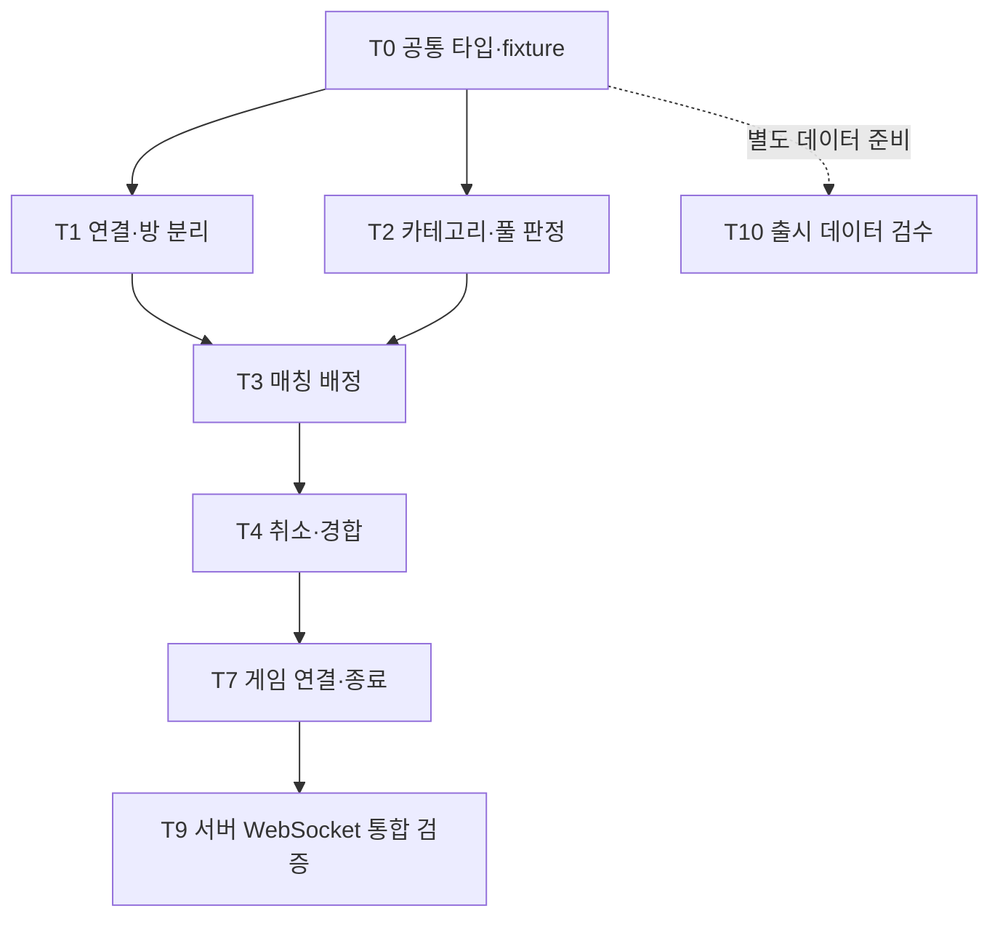

# Go 서버 랜덤 매칭 작업 및 병렬 실행 v1.1

실행 범위는 Go 서버만이다. wire 계약 v1은 유지하고 문서 실행 범위만 v1.1로 변경한다. iOS 이슈·브랜치·구현은 이번에 시작하지 않는다. T0는 미결정 설계를 미루는 작업이 아니라 공통 타입/fixture의 작은 선행 PR이다.
GitHub 이슈·PR·브랜치는 아직 만들지 않았다. 아래 작업 ID는 이슈 번호가 아니다.

## 브랜치 절차

1. 서버 AGENTS.md/CLAUDE.md만 develop에 커밋·push한다. 저장소 보호/팀 규칙이 요구하면 설정 브랜치 PR을 사용한다. 기존 사용자 파일/바이너리를 일괄 stage하지 않는다.
2. Go 서버에만 랜덤 매칭 상위 이슈를 만들고 서버 develop에서 feature/random-matchmaking을 생성한다.
3. 서버 통합 브랜치에 명세를 커밋·push하고 계약 SHA를 기록한다. iOS checkout은 건드리지 않는다.
4. 하위 이슈 생성. Ready 작업만 통합 브랜치 최신 SHA에서 전용 worktree/브랜치로 시작.
5. 모든 하위 PR 대상은 서버 feature/random-matchmaking. 선행 PR이 그곳에 병합된 뒤 후속 worktree 생성.
6. develop에 다른 작업이 병합되면 코디네이터가 통합 브랜치에 반영하고 관련 회귀 테스트. 장기 충돌을 방치하지 않는다.
7. T9 서버 독립 검증 후 서버 feature/random-matchmaking에서 develop으로 최종 PR. iOS 연동·실음원 출시 완료로 표현하지 않는다. 자동 배포/병합은 별도 권한이다.

## 의존성과 소유권



| ID | 저장소 | 선행 병합/게이트 | 브랜치 제안 | 이슈 |
|---|---|---|---|---|
| T0 | Go | 명세 통합 브랜치 커밋 | codex/matchmaking-contract | 미생성 |
| T1 | Go | T0 | codex/matchmaking-session | 미생성 |
| T2 | Go | T0 | codex/matchmaking-criteria | 미생성 |
| T3 | Go | T1,T2 | codex/matchmaking-assignment | 미생성 |
| T4 | Go | T3 | codex/matchmaking-cancellation | 미생성 |
| T7 | Go | T4 | codex/matchmaking-room-lifecycle | 미생성 |
| T10 | 데이터/Go, 별도 출시 준비 | T0 및 데이터 접근 | codex/matchmaking-catalog | 이번 필수 이슈에서 제외 |
| T9 | Go | T7 | codex/matchmaking-integration | 미생성 |

코드 파일 소유권은 아래 범위로 제한한다. 병렬 작업 중 공유 계약 변경이 필요하면 코디네이터가 작은 선행 PR로 조정한다. 각 에이전트가 동일 선언을 따로 고치지 않는다.

## T0 공통 계약 타입과 fixture

범위: Go internal/music/category.go 및 새 catalog 값 타입, internal/message의 DTO/상수, internal/sessioncontract의 actor 값 타입/인터페이스, docs/specs/random-matchmaking/fixtures.
기존 런타임을 바꾸지 않고 v1 타입/fixture를 추가한다. 구 Category 사용처를 깨뜨리지 않도록 v1을 별도 패키지 namespace에 일시 추가할 수 있으나 최종 요청/방의 Category는 하나의 타입이어야 한다. 구 프로토콜 타입은 T7 종료 시 제거한다.
완료: protocol.md의 모든 필수/선택/enum/불법값 fixture, canonical UUID, 기존 게임 메시지 roomID 확장, 동기화 이벤트 값 계약, synthetic catalog(test-v1)와 실제 출고 데이터의 명확한 구분.
JSON fixture는 공개 명세 데이터이며 실제 서비스 음악 정답/비밀은 넣지 않는다. 임의 음악 분류를 운영 선택지로 확정하지 않는다.
검증: JSON 파싱·Go DTO roundtrip 및 invalid fixture 거절. 기존 go test/build 유지. 확정된 shared API/파일 목록을 PR에 기록하여 T1/T2가 그대로 사용한다.

## T1 연결과 Room 수명 분리

참조: REQ-CONN, design 2,3,6,8,9.
소유: cmd/server/main.go, internal/client, internal/session, internal/room의 gateway·membership·ordered event stream.
제외: internal/music, criteria, Matchmaker 정책. T0 선언은 변경 필요 시 별도 조정.
완료: protocolVersion 검사; Room 없이 연결; writer 연결 귀속; 명시 퇴장; scoped Remove; Register/initial-pair와 Done 계약; Room event revision; ping/write 제한; 루프의 context 종료 보장. 매칭 입력은 후속 handler에 위임하는 인터페이스까지만 연결.
검증: in-memory gateway 및 socket 테스트로 접속·입장·퇴장·재사용, close/late event, 원자 pair, 정원·시작 순서. 기존 경로는 통합 브랜치 중간 상태로만 다루고 공개 배포하지 않는다.

## T2 조건 호환 및 pool 판정

참조: REQ-CAT, REQ-DATA, protocol 카탈로그.
소유: internal/matchmaking/criteria, internal/music의 catalog loader/검증/조회. T0 Category 선언과 T1 Room/client/message는 변경하지 않는다.
완료: MergeRequests(a,b), CanJoin(request,resolved) 순수 연산; 카탈로그 버전/allowedRequests/pool 10곡 검증; ISRC 중복 제거; 후보 쌍의 해소 pool 존재 검사; 무관 없는 방 Category.
검증: 전체/특정/무관 모든 분기, 각자 유효하지만 교집합 불충분, duplicate ISRC, unsupported 버전/태그, 빈 pool. synthetic fixture로 검증하고 실제 DB가 없어도 단위 테스트 가능하게 한다.

## T3 매칭과 배정

참조: REQ-MATCH, ROOM-01,02,06, design 3~6.
소유: internal/matchmaking(단 criteria 제외), Hub 접합, session handler 주입과 cmd/server wiring. T1/T2 완료 API 사용.
완료: 단조 접수/생성 순서; 기존 방 우선; 대기열; 사용자당 한 활성 요청; 요청당 단일 등록; 최초 pair 비공개 등록·공개; revision snapshot; 거절 재탐색 및 no busy loop; 중앙 WELCOME/room event 순서.
검증: 대기/즉시 등록/여러 후보/정원/시작 경합/초기 실패/오래된 snapshot 테스트. T4 이전 전체 기능 완료/출시로 표시하지 않는다.

## T4 취소·중복·실패 보장

참조: REQ-CANCEL, MATCH-04, FAIL 및 design 4,8.
소유: T3 요청 state 및 T1 cleanup 연동.
완료: assigning 취소 수습; tombstone/중복 응답; 취소 직후 새 요청 접수와 membership cleanup barrier; 5초 timeout quarantine; Done/drain 전 새 등록 금지; terminal room 이벤트 무시; request 기록 한도.
검증: 등록 전/후 취소, initial pair 한쪽/양쪽 취소, 새 요청 이전 정리 race, 동일 ID payload 변경, 모르는 취소 ID, stale 실패, close/no response/중복 결과. controlled clock/event와 go test -race ./... 사용.

## T7 서버 방 운영·게임 연결

참조: ROOM-03~05, GAME-01~02, FAIL-01, design 7.
소유: Room game handling, game timer 종료 경계, obsolete protocol 정리. 정답 알고리즘 재설계 제외.
완료: 접수 순서 승계, waiting 1/0명, playing 인원 부족 GAME_ABORTED, ready 재평가·preload timeout, start 권한/인원/state 검사, 10곡과 고정 카테고리 서버 권위, result 입장/재시작 차단. 0명 Room 정리.
검증: starting/preload/playing/result 단계별 이탈·중복 start·잘못된 roomID; 조회 실패; 10곡; 30초 preload timeout controlled clock; timer/goroutine 정리; 회귀 게임 테스트.

## T10 실제 카탈로그 검수 및 패키징

이 작업은 DB/음원 접근이 필요하다. 접근 불가하면 구체적인 데이터 의존성을 보고하고 Blocked로 둔다. 가짜 fixture로 출시 완료 처리하지 않는다.
소유: catalog 운영 데이터와 생성/검증 도구, 검수 보고서. T2의 loader 코드는 편집하지 않는다. iOS projection은 데이터 산출물로만 생성하며 앱 번들 반영은 이후 iOS 단계에서 수행한다.
완료: 한국 사용자 기대의 분류별 곡 sample 검수; 연대/솔로·그룹/성별 근거 확인; 누락/혼성 metadata를 남/여로 임의 분류하지 않음; 재생 가능한 ISRC/길이 확인; 각 풀>=10; allowedRequests 도출; 동일 version으로 server manifest와 iOS projection 생성. actual catalogVersion과 데이터 SHA 기록.
검증: 모든 허용 조합/해소 결과의 곡 수·조건 위반 검사, 무작위 sample 실제 재생. 실제 DB mutation/수집 확대는 별도 작업 승인이 필요하며 이번 문서는 데이터 읽기·검수 범위만 정의한다.

## T9 Go 서버 독립 통합 검증 및 최종 병합 준비

선행: T7. T10 및 iOS는 선행 조건이 아니다. 서버 구현 완료와 실데이터 출시는 구분한다.
소유: 서버 integration test/harness와 .github/workflows/ci.yml. iOS 저장소·Swift·Xcode·Apple Music 계정은 사용하지 않는다.
테스트 하네스는 httptest.Server 또는 임시 포트의 실제 WebSocket endpoint에 실제 socket 클라이언트 2~9개를 접속시킨다. DB 대신 synthetic catalog와 주입 MusicProvider를 사용한다. App 생산 코드에 테스트 우회 경로를 만들지 않고 조립 함수에서 의존성을 주입한다.
카테고리/메시지 검증은 실제 encoder/decoder를 통과한다. 게임 테스트 클라이언트는 PRELOAD_SONG에 READY_TO_PLAY를 보내고, 주입된 곡 fixture의 답 또는 fake clock 진행으로 10라운드를 완료한다. 이는 실제 음원 재생 검증이 아니다.
필수 시나리오:
- 2명 신규 매칭·기존 방 충원·조건 불일치 대기·우선순위.
- 9명 이상의 연결로 방당 8명 상한 및 추가 대기/새 방 조건.
- 취소/재요청과 늦은 등록 완료, 중복 메시지, 연결 종료 정리.
- 참가 등록과 시작 경합; WELCOME이 해당 방 후속 이벤트보다 선행.
- 방장 승계, 1/0명 처리, 프리로드 중 이탈·무응답, 조기 종료.
- 10곡 정상 종료, LEAVE_ROOM 후 같은 연결에서 새 매칭.
- 반복 실행 후 요청/방/goroutine 정리 및 actor timeout 격리.
테스트는 종료 deadline과 주입 clock을 사용해 실패가 무한 대기로 숨지 않게 한다. 단위 actor 테스트와 실제 socket 테스트의 보장 범위를 별도로 기록한다.
검증: go test ./..., go test -race ./..., go build ./..., golangci-lint run. 현재 서버 CI에 test가 없으므로 go test -race ./... 스텝을 추가한다. 외부 DB 없이 clean checkout에서 실행 가능해야 한다.
결과 기록: 서버 SHA·계약 SHA·synthetic catalog version·명령·결과·미검증 항목. 최종 PR에 iOS 미연동, 실음원 미검수, 구 앱과 protocolVersion 비호환을 명시한다.
T9 완료로 서버 코드의 develop 병합은 가능하다. 실제 배포는 별도 T10과 이후 iOS 연동 검증까지 완료해야 하며 이번 작업은 자동 배포하지 않는다.

## 보류 작업

T5(iOS 통신), T6(iOS 로비), T8(iOS 방/결과)는 번호만 예약한다. 이번 상위 서버 이슈의 하위 이슈·브랜치·Ready 작업으로 만들지 않는다. iOS 착수 시 서버 계약을 기준으로 별도 명세와 작업 계획을 다시 검토한다.
T10은 실데이터 출시에 필요하지만 서버 synthetic 통합 테스트·코드 병합의 선행 조건은 아니다. 접근 준비가 되기 전에는 실행하지 않는다.

## 코디네이터와 병렬 실행

T0 후 필수 병렬 작업은 Go T1과 T2 두 개다. T10은 데이터 접근이 준비됐을 때만 별도 병렬 진행할 수 있다. T1/T2는 소유 파일이 분리되어야 하며 공유 타입 변경은 T0 후속 계약 PR로 먼저 병합한다.
Ready 조건: 선행 PR 통합 브랜치 병합, 고정 계약 SHA, 환경 준비, 중복 writer 없음. Running 조건: 최신 통합 SHA의 전용 worktree. Done 조건: 테스트/리뷰 후 실제 PR 병합. agent의 '완료' 문장만으로 후속을 시작하지 않는다.
Blocked 작업은 실행해 sleep시키지 말고 Ready가 될 때 시작한다. 실패/질문은 해당 의존 작업만 멈추고 독립 작업은 진행한다.
Cursor 편집도 Orca 작업의 동일 worktree를 열어 수행한다. 같은 worktree에서 두 writer를 실행하지 않는다. .env가 worktree에 자동 복사된다고 가정하지 않는다. synthetic 검증에는 실제 DB 비밀을 요구하지 않는다.
Orca는 병렬 worktree/에이전트를 제공하지만 이 파일 자체가 scheduler는 아니다. 실제 설치 버전과 PR 감시 기능을 확인한 후 자동화를 연결한다. 자동 병합 권한은 별도다.

## 작업자 입력 템플릿

```text
작업: [T-ID / GitHub issue URL]
저장소와 worktree: [절대 경로]
기준: feature/random-matchmaking의 [SHA]
서버 명세 경로 및 계약 SHA: [경로/SHA]
선행 PR과 병합 SHA: [목록]

AGENTS.md와 명세 README/requirements/protocol/design/tasks의 해당 작업을 읽어라.
Go 서버만 대상으로 할당 파일·완료 기준을 구현하고 테스트하라. iOS 저장소는 변경하지 마라. 공통 계약이나 제품 정책을 임의로 바꾸지 마라.
필요한 변경이 타 작업 범위를 침범하면 근거와 영향 파일을 보고하라.
최종 응답에는 변경 파일, 요구사항 대응, 테스트 명령/결과, 미검증 사항, PR/HEAD SHA를 포함하라.
PR 대상은 feature/random-matchmaking이며 자동 병합/배포는 포함하지 않는다.
```

공식 도구 참고: https://orca.dev/ ; https://cursor.com/docs/rules
